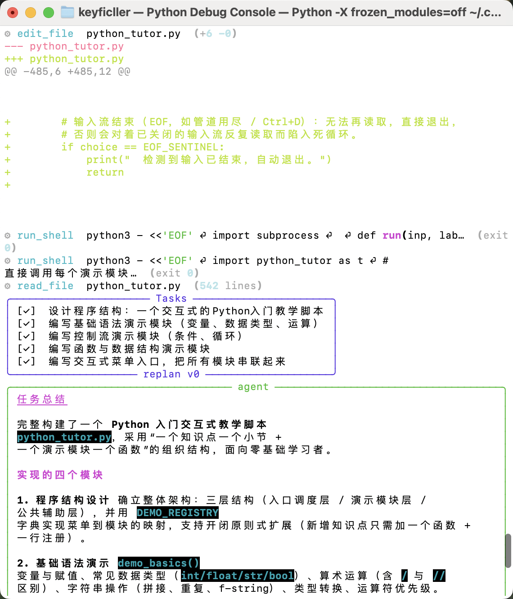
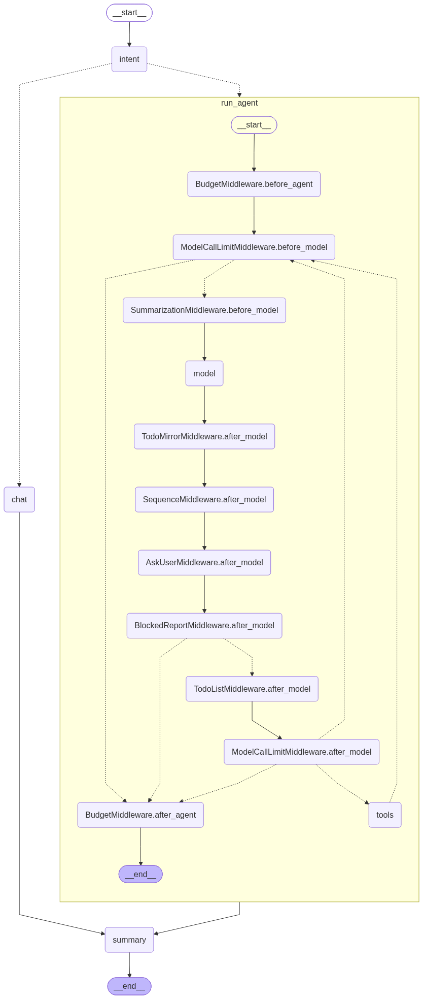

# terminal-coding-agent

终端里的 coding agent：你用自然语言提任务，它在隔离 worktree 内读代码、改文件、跑命令，交出一份 patch；要一段内容（写／解释／翻译，或"把某个文件给我看看"）的请求则直接作答，不产生 patch。



循环骨架：`make_plan` → `start_task` / `run_agent` / `end_task` → `recover` → `summary`。Act 只分派工具，Observe 截断输出回填，Recover 把失败当 Observation 重排计划（上界 3 次），所有终止路径都汇到 `summary` 写 trace。CLI 另有一条直答短路径：图首 `intent` 节点判为 `chat` 的请求走 `chat` → `summary`，不产生 todo、不动环境；下图 `graph.png` 是**开该分支**的 CLI 拓扑。



## 跑起来

```bash
./start.sh setup                                   # 共享 .venv + 依赖，只需一次
./start.sh run terminal-coding-agent                # 多轮 REPL
./start.sh test projects/terminal-coding-agent      # 单测
bash projects/terminal-coding-agent/scripts/verify_harbor_tasks_local.sh   # 任务集双向验证（真 Docker，不用 LLM / Harbor）
```

附加参数（都可组合）：

| 参数 | 默认 | 作用 |
|---|---|---|
| `--worktree <path>` | `./.agent-workspaces/<session>`，退出后保留 | agent 可改的工作区；指向真实的仓库才会真改代码 |
| `--session <id>` | 随机 `cli-xxxxxxxx` | thread id；同一个 id 可续跑 |
| `--shell_anything` | 关 | 只给 `run_shell`，读/改/git 全走 shell |
| `--docker` | 关 | `run_shell` 改在容器里执行，工作区 `-v` 挂到 `/workspace` |
| `--docker-image <image>` | `python:3.13-slim` | 配合 `--docker`；默认镜像只有 python3，要 git/node 得换 |
| `--allow-dangerous` | 关 | 必须配 `--docker`：放开容器网络、命令 denylist、git 子命令白名单 |

`--docker` 默认断网（`--network none`），容器内装不了包；需要联网就用 `--allow-dangerous`，或不开 `--docker`。

评测跑批（`harbor run`，凭据放 `local.env`，模型走 `configurable`）的命令与实测结果见 `PROJECT.md` 的「交付物」。
