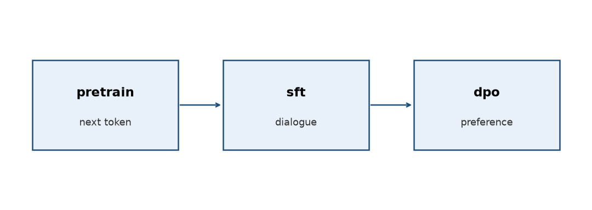

# tiny-llm-pipeline

从零训练一个约 29M 的中文小模型（词表 6400、宽 512、8 层），走通预训练接龙 → SFT → DPO 对齐豆包体，并附一个三阶段对照页。



三段数据流：`prepare` 拉语料并切出预训练 bin 与三份互不相交的 SFT 切分 → `synth-pref` 合成偏好对 → `train-pretrain` / `train-sft` / `train-dpo` 逐段训练，每段都从上一段的 `ckpt.pt` 出发（DPO 的 `ref` 是冻结的第二份拷贝）。

## 跑起来

交付版本的三段权重在 [HF `KeyFicller/tiny-llm-pipeline-29m`](https://huggingface.co/KeyFicller/tiny-llm-pipeline-29m)，按下面的顺序拉下来即可评测与查看。

```bash
./start.sh setup                                                        # 共享 .venv + 依赖，只需一次
P=projects/tiny-llm-pipeline

./start.sh run python $P/checkpoints/sync_ckpt.py pull                  # 三段权重 + tokenizer（先拉，重训时 prepare 会复用这份 tokenizer）
./start.sh run tiny-llm-pipeline eval --stages pretrain,sft,dpo \      # 40 条冻结题上按贪心评测，写 eval/results.jsonl（唯一报数来源）
    --prefix "用豆包体回答：" --max-new 128
./start.sh run python $P/eval/sample.py --rep-pen 1.5                   # 离线抽样，逐条看三段回复
./start.sh run python $P/eval/serve.py --open                           # 三段并排对照页
./start.sh test projects/tiny-llm-pipeline                              # 单测
```

从零重训（会重新下载语料并打包，约 200MB 采样）：

```bash
./start.sh run tiny-llm-pipeline prepare --out $P/artifacts/data        # 拉语料 → 训 tokenizer → 打包 bins 与三份切分
./start.sh run tiny-llm-pipeline synth-pref --n 1000 \                  # 合成偏好对；追加式，中断可续跑
    --prompts $P/artifacts/data/dpo_prompts.jsonl \
    --out $P/artifacts/prefs/prefs.jsonl --data $P/artifacts/data
./start.sh run tiny-llm-pipeline train-pretrain --data $P/artifacts/data --out $P/checkpoints/pretrain
./start.sh run tiny-llm-pipeline train-sft --data $P/artifacts/data \
    --base $P/checkpoints/pretrain/ckpt.pt --out $P/checkpoints/sft --max-steps 5000
./start.sh run tiny-llm-pipeline train-dpo --data $P/artifacts/data \
    --prefs $P/artifacts/prefs/prefs.jsonl --ref $P/checkpoints/sft/ckpt.pt \
    --out $P/checkpoints/dpo --beta 0.1 --epochs 1 --lr 1e-5 --max-steps 100   # 交付配置，--ref 全程只读
```

只验证接线：三处 `--max-steps` 设 `3`、`train-sft` 加 `--limit 32`（`sft_train.jsonl` 有 112 万行，逐行流式读）；`synth-pref` 需自备 `DEEPSEEK_API_KEY`。

三段读数见 `eval/results.jsonl`，口径与退化护栏见 `PROJECT.md`。生成必须开 `repetition_penalty`（1.3–1.5）、`--max-steps` 决定余弦视野、`checkpoints/` 与 `artifacts/` 被 gitignore（`artifacts/prefs/` 需随机器搬运）。
